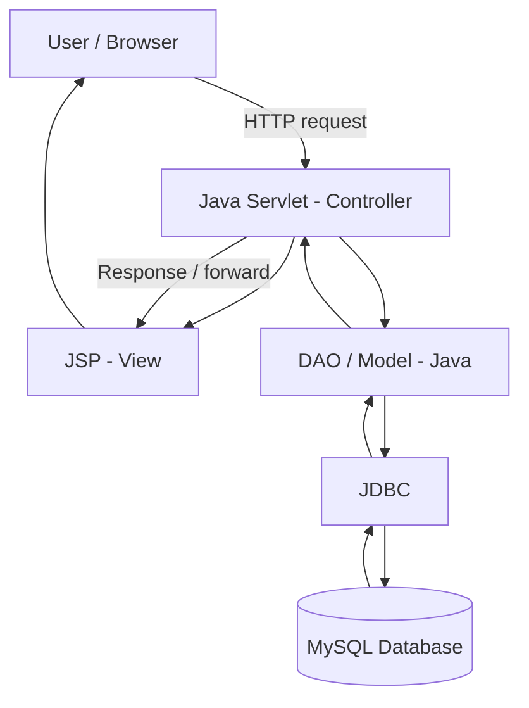
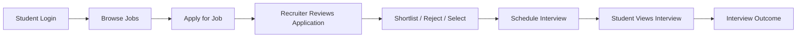
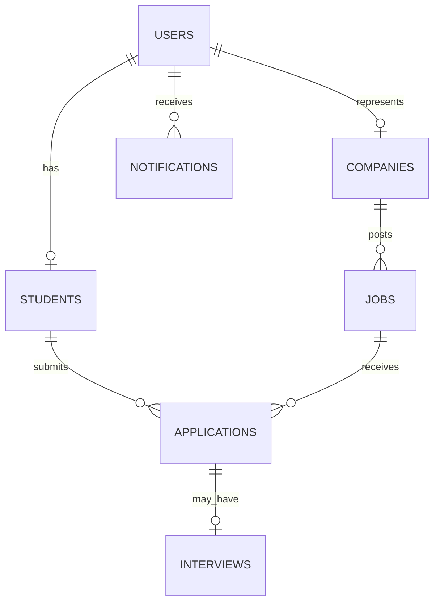

<div align="center">

# 🎓 Campus Connect
### College Placement & Internship Management System

**One platform to organize campus placements—from job discovery to interview scheduling.**

<p>
  <a href="https://campus-connect-production-8935.up.railway.app/campus-connect/login.jsp"><strong>🌐 Open Live Demo</strong></a>
  &nbsp; · &nbsp;
  <a href="https://github.com/vinodyadav895880-dotcom/campus-connect"><strong>💻 View Source Code</strong></a>
  &nbsp; · &nbsp;
  <a href="docs/Campus_Connect_Final_Report.pdf"><strong>📄 Project Report</strong></a>
</p>


**Academic Project · 2026–27**  
Team Leader: **Vinod Yadav** · Guide: **Er. Ram Babu Buri**

</div>

---

## 📌 Table of Contents

- [Overview](#-overview)
- [Problem and Solution](#-problem-and-solution)
- [Features](#-features)
- [Technology Stack](#-technology-stack)
- [Architecture](#-architecture)
- [Application Workflow](#-application-workflow)
- [Database Design](#-database-design)
- [Security and Configuration](#-security-and-configuration)
- [Run Locally](#-run-locally)
- [Deployment](#-deployment)
- [Project Structure](#-project-structure)
- [Testing Evidence](#-testing-evidence)
- [Documentation](#-documentation)
- [Team Contributions](#-team-contributions)
- [Limitations and Future Enhancements](#-limitations-and-future-enhancements)
- [Academic Details](#-academic-details)

## 🚀 Overview

**Campus Connect** is a Java-based web application for managing college placement and internship activities. It provides role-based areas for **Students, Recruiters, and Administrators**, helping bring job listings, applications, interview schedules, and placement monitoring into one place.

The project is built with Java web technologies, uses MySQL for persistent data, and is deployed on Railway for an online demonstration.

> **Live application:** [Open Campus Connect](https://campus-connect-production-8935.up.railway.app/campus-connect/login.jsp)  
> **Repository:** [vinodyadav895880-dotcom/campus-connect](https://github.com/vinodyadav895880-dotcom/campus-connect)

The live deployment uses demonstration data for academic evaluation. Do not enter private, sensitive, or real student information into the public demo. Demo credentials are not published in this repository.

## 🎯 Problem and Solution

Placement activity can be spread across spreadsheets, forms, emails, and separate messages. This can make opportunities, application statuses, interview schedules, and placement statistics harder to track.

Campus Connect brings the core workflow into one database-backed application:

- Students can explore opportunities and follow their applications.
- Recruiters can manage jobs and review candidates.
- Administrators can monitor placement activity and view summary information.

## ✨ Features

<table>
  <tr>
    <th>🎓 Student</th>
    <th>🏢 Recruiter</th>
    <th>🛡️ Administrator</th>
  </tr>
  <tr>
    <td>
      <ul>
        <li>Login and profile access</li>
        <li>Browse jobs and internships</li>
        <li>Apply for opportunities</li>
        <li>Track application status</li>
        <li>View interviews and results</li>
      </ul>
    </td>
    <td>
      <ul>
        <li>Manage company details</li>
        <li>Create and manage job postings</li>
        <li>Review student applications</li>
        <li>Shortlist, reject, or select candidates</li>
        <li>Schedule interviews and update outcomes</li>
      </ul>
    </td>
    <td>
      <ul>
        <li>Centralized dashboard</li>
        <li>Monitor students and recruiters</li>
        <li>Monitor companies, jobs, and applications</li>
        <li>View placement-related summaries and reports</li>
      </ul>
    </td>
  </tr>
</table>

## 🧰 Technology Stack

| Layer / Tool | Technology | Purpose in this project |
|---|---|---|
| Programming language | Java 21 | Business logic and application processing |
| View layer | JSP, HTML5, CSS3, JavaScript | Pages, forms, and browser interactions |
| Request handling | Java Servlets | HTTP requests, validation, sessions, navigation |
| Database access | JDBC | Execute SQL statements and connect Java to MySQL |
| Database | MySQL | Store users, profiles, jobs, applications, and interviews |
| UI framework | Bootstrap 5 | Responsive layout and reusable UI components |
| Web runtime | Apache Tomcat 9 | Run the JSP/Servlet application |
| Build tool | Apache Maven | Manage dependencies and build the WAR package |
| Container | Docker | Define the build and runtime environment |
| Cloud hosting | Railway | Host the application and MySQL service |
| IDE and collaboration | Eclipse, Git, GitHub | Development, version history, and team collaboration |

## 🏗️ Architecture

Campus Connect follows the **Model–View–Controller (MVC)** pattern. JSP pages provide the View, Servlets act as Controllers, and Java model/DAO classes handle application data and database operations.



**Deployment components:** Maven builds the WAR package, Docker defines the build/runtime configuration, Tomcat runs the application, and Railway hosts the live application and database services.

## 🔄 Application Workflow



### Role-based workflows

- **Student:** Login → Browse jobs → Apply → Track status → View interview and result.
- **Recruiter:** Login → Manage company/jobs → Review applications → Update candidate status → Schedule interview → Update result.
- **Administrator:** Login → Dashboard → Monitor users/jobs/applications → Review placement summaries.

## 🗃️ Database Design

The schema is available at [`database/campus_connect_schema.sql`](database/campus_connect_schema.sql).

| Table | Purpose |
|---|---|
| `users` | Authentication details and user role |
| `students` | Student profile and academic details |
| `companies` | Recruiter/company information |
| `jobs` | Placement and internship opportunities |
| `applications` | Student-to-job applications and status |
| `interviews` | Interview schedule, mode, and result |
| `notifications` | User-specific notification records |

### Main relationships



Primary keys identify records; foreign keys connect related records. Administrator access is represented by the user role.

## 🔐 Security and Configuration

Security-related practices implemented in the project include:

- BCrypt password hashing and verification.
- Parameterized SQL queries using `PreparedStatement`.
- Server-side input validation.
- Session-based login state and logout/session invalidation.
- Role-aware access for Student, Recruiter, and Administrator areas.
- Database configuration through environment variables rather than hard-coded credentials.

**Production note:** Before using the application with real college or student data, conduct a security review, verify authorization on every protected route, configure backups and monitoring, and establish privacy and data-retention practices. This academic demo has not been presented as a formal security audit.

## 💻 Run Locally

### Prerequisites

- JDK 21
- MySQL
- Apache Maven
- Apache Tomcat 9 for manual deployment
- Eclipse IDE for Enterprise Java and Web Developers (optional)
- Git

### 1. Clone the repository

```bash
git clone https://github.com/vinodyadav895880-dotcom/campus-connect.git
cd campus-connect
```

### 2. Create the database schema

Run this from a terminal where the MySQL client is installed and the selected account has permission to create the database:

```bash
mysql -u root -p < database/campus_connect_schema.sql
```

This command creates the database schema. It does not automatically guarantee demo users or sample data are present.

### 3. Configure database environment variables

Set these in the environment used to run Tomcat, replacing the example values with your local MySQL credentials:

```bash
export CAMPUS_DB_URL='jdbc:mysql://localhost:3306/campus_connect?serverTimezone=UTC'
export CAMPUS_DB_USER='your_mysql_username'
export CAMPUS_DB_PASSWORD='your_mysql_password'
```

Do not commit real credentials to GitHub. In Eclipse, configure the same variables in the Tomcat launch environment if you start the server from the IDE.

### 4. Build the application

```bash
mvn clean package
```

If the build succeeds, Maven should create the WAR package under `target/`.

### 5. Run on Tomcat

Import the repository into Eclipse as an **Existing Maven Project**, select JDK 21, configure Tomcat 9 and the database environment variables, then run the project on the server. Alternatively, deploy the generated WAR to Tomcat. For more setup and troubleshooting details, see [`docs/Project_Run_Guide.md`](docs/Project_Run_Guide.md).

## ☁️ Deployment

The public demo is hosted on **Railway** using a Dockerfile-based deployment.

- `Dockerfile` defines the Maven build stage and Tomcat runtime stage.
- `docker-entrypoint.sh` configures Tomcat's HTTP connector from the hosting platform's port value and starts Tomcat.
- `.dockerignore` excludes items such as Git metadata, local logs, build output, and local environment files from the Docker build context.
- Railway service variables provide `CAMPUS_DB_URL`, `CAMPUS_DB_USER`, and `CAMPUS_DB_PASSWORD` to the application.

**Live URL:** [Campus Connect Login](https://campus-connect-production-8935.up.railway.app/campus-connect/login.jsp)

Never publish database passwords, SSH private keys, or other secrets in this README or source control.

## 📁 Project Structure

```text
campus-connect/
├── database/
│   └── campus_connect_schema.sql
├── docs/
│   ├── Campus_Connect_Final_Report.pdf
│   ├── Campus_Connect_SRS.md
│   ├── Project_Run_Guide.md
│   ├── Testing_Documentation.md
│   ├── Weekly_Progress_Tracking.md
│   ├── Use_Case_Diagram.png
│   ├── Class_Diagram.png
│   └── ER_Diagram.png
├── src/main/java/com/campusconnect/
│   ├── controller/
│   ├── dao/
│   ├── model/
│   └── util/
├── src/main/webapp/
│   ├── admin/
│   ├── recruiter/
│   ├── student/
│   ├── css/
│   ├── js/
│   └── login.jsp
├── .dockerignore
├── Dockerfile
├── docker-entrypoint.sh
├── pom.xml
└── README.md
```

## ✅ Testing Evidence

The following core flows were manually exercised on the live demonstration:

- Administrator login and dashboard access.
- Student login and dashboard access.
- Loading placement and internship listings.
- Submitting a student job application.
- Viewing the submitted application from the recruiter area.
- Shortlisting an application.
- Scheduling an interview from the recruiter area.
- Verifying the scheduled interview in the student area.

This describes manual functional checks; it is not a claim of automated test-suite coverage or a formal security audit.

## 📚 Documentation

- [Final Project Report (PDF)](docs/Campus_Connect_Final_Report.pdf)
- [Software Requirements Specification](docs/Campus_Connect_SRS.md)
- [Project Run Guide](docs/Project_Run_Guide.md)
- [Testing Documentation](docs/Testing_Documentation.md)
- [Weekly Progress Tracking](docs/Weekly_Progress_Tracking.md)
- [Use Case Diagram](docs/Use_Case_Diagram.png)
- [Class Diagram](docs/Class_Diagram.png)
- [ER Diagram](docs/ER_Diagram.png)
- [Database Schema](database/campus_connect_schema.sql)

## 👥 Team Contributions

| Team member | Primary responsibility |
|---|---|
| **Vinod Yadav — Team Leader** | Authentication, integration, deployment coordination, and GitHub workflow |
| Ritika Yadav | Student module |
| Shalini Priya | Applications and interviews |
| Rakshit Sharma | Recruiter, company, and jobs modules |
| Akshara Prashar | Administrator module and reports |

Team members should be credited in line with the actual work completed and the evidence maintained by the team.

## 🔭 Limitations and Future Enhancements

Potential future improvements include:

- Email and real-time notifications.
- Advanced job search and filtering.
- Resume document management.
- Automated eligibility checks.
- Online aptitude assessments.
- PDF/Excel report export and richer placement analytics.
- Expanded monitoring, automated backups, and production hardening.

## 🎓 Academic Details

- **Project:** Campus Connect — College Placement & Internship Management System
- **Academic year:** 2026–27
- **Project type:** Java web application
- **Team leader:** Vinod Yadav
- **Guide:** Er. Ram Babu Buri

---

<div align="center">

**Campus Connect**  
*Making college placement workflows more organized, accessible, and easier to track.*

[🌐 Live Demo](https://campus-connect-production-8935.up.railway.app/campus-connect/login.jsp) · [💻 GitHub Repository](https://github.com/vinodyadav895880-dotcom/campus-connect)

</div>
